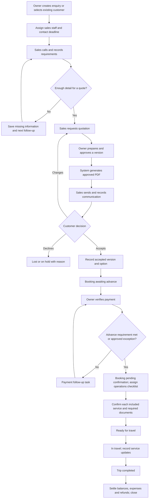

# Product and workflow - draft for approval

## Purpose

Give the owner and staff one shared place to answer: Who is the customer? What do they need? Who is responsible? What happens next? What has been promised, paid and confirmed?

Support domestic/international trips, honeymoon/family/group enquiries, full packages, hotel-only, car-only, ticket assistance and combinations. A booking may contain an agency-booked hotel and transfer alongside a customer-booked flight or train. Ferry/boat legs are supported because the Andaman and Kerala samples require them.

## Three roles

- Owner: capture enquiries, assign work, prepare/approve prices, verify money, approve commitments/changes/refunds, oversee reports and settings.
- Sales: work assigned enquiries/customers, gather requirements, call/follow up, request quotations, send approved PDFs, record acceptance evidence, submit payment evidence and coordinate approved hotel/supplier/driver arrangements.
- Operations: execute assigned services. Drivers see assigned journeys and can report updates/issues. Owner may grant selected logistical edit or draft-request capabilities. Owner and sales remain the default coordinators.

Routine notes, follow-ups and trip status updates save directly. Financial commitments, pricing, exceptional changes and refunds need owner approval. Requiring owner approval for every note would slow down the team.

## Main flow

Advance verification opens operations work; it never claims that a hotel, ticket or vehicle is already confirmed.

## Example A: couple with their own flight tickets

1. A couple already booked flights to Kochi. They request Munnar hotel, Alleppey houseboat and car transfers.
2. Owner selects their existing customer record or creates one, then assigns sales.
3. Sales records two adults, arrival/departure times, desired dates, pickup/drop points, room preference, budget and flight reference if available. Flights are marked Customer booked / not charged by agency.
4. Sales requests a quote. Owner selects a Kerala template, checks actual availability/rates and prepares hotel/meal options.
5. Owner approves version 1. PDF generation creates a sales task: Send quotation. Sales records when and how it was sent.
6. Customer chooses one option. Sales records the accepted version/option and evidence. Owner verifies the agreed advance.
7. The system creates hotel, houseboat, car assignment and pre-travel checks. The owner or assigned sales executive coordinates the booking; drivers only receive their assigned car legs.
8. Confirmations produce hotel vouchers, itinerary and a minimal driver trip sheet. A flight time change creates a transfer review task.
9. Operations completes the trip. Outstanding money remains visible until settled; trip completion alone cannot clear a balance.

## Example B: hotel-only booking

Customer already has train tickets and needs two nights in a hotel. Collect hotel dates, location, rooms, guests and meal preferences. Skip itinerary/vehicle fields. Record train arrival only if relevant to check-in. Quote, accept, verify payment, confirm hotel, issue voucher and settle. No driver task is generated.

## Example C: international package

Use the same flow with multiple countries/cities, local time zones, customer or agency-booked flight legs, nationality, document readiness and optional visa assistance. Add foreign supplier currency and the owner's recorded conversion rate. Passport/visa information is requested only when needed for the services. Document requirements are checked by authorized staff against current destination/carrier requirements, not assumed from an old package template.

## Screens kept simple

User confirmed there are no fixed group departures. Keep group-trip interest as an ordinary enquiry preference with destination/month and follow-up; support family/private group passenger counts. Do not add shared seat capacity, holds, waitlists or departure inventory screens.

| Screen | Purpose |
|---|---|
| My day | Overdue, today, upcoming, waiting and recently completed work |
| Enquiries | Customer request, conversation, stage, next action and quotation request |
| Customers | Contact profile and past enquiries/bookings; no duplicated trip fields |
| Quotations | Owner preparation/approval queue; sales approved quotes to send |
| Bookings | Summary, itinerary/services, travellers, documents, payments and activity |
| Tasks | Personal to-dos and calendar; owner has team view |
| Suppliers and resources | Hotel/transport vendors, own vehicles and driver availability |
| Finance | Invoices, receipts, customer/supplier payments, refunds and recoveries |
| Reports | Owner's sales, collections, costs and workload reports |
| Settings/imports | Owner controls staff access, templates, policies and migration |

Only permitted screens appear. Drivers mainly see My trips and My tasks. Each record has one prominent next action, plain labels, useful defaults, progressive sections, save-draft support and a timeline. Desktop tables become readable cards on phones. Filters and search respect the same access rules as record pages.

## Separate states

- Enquiry: New, Contacting, Gathering details, Quote requested, Quote sent, Won, On hold, Lost. Contact outcome and next follow-up are separate fields.
- Quote: Draft, Approved, Sent, Accepted, Rejected, Expired, Superseded. Approval and PDF generation have separate status so a failed job can retry.
- Booking: Awaiting advance, Pending confirmation, Confirmed/Ready, In travel, Completed, Cancelled. Financial settlement is a separate flag.
- Arrangement: Planned, Requested, On hold, Confirmed, Rejected, Cancelled, Completed.
- Task: To do, In progress, Waiting, Done, Cancelled. Overdue is calculated from due date; it is not another status staff must choose.

Every critical transition has a permission check and prerequisites. Going backwards requires a recorded reason and preserves history.
