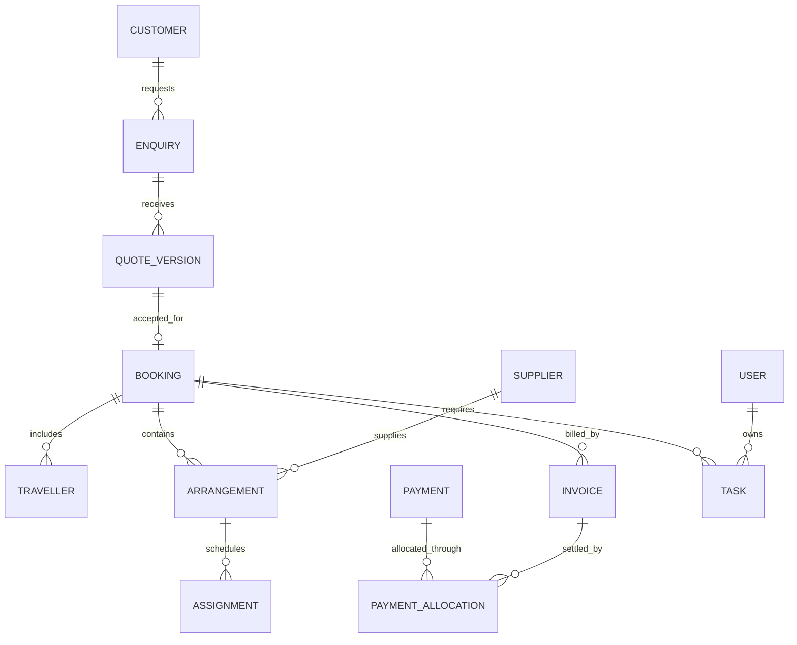

# Technical architecture and delivery plan

## Proposed stack

- Next.js App Router, strict TypeScript, supported stable Node.js and pinned dependencies selected after approval.
- Tailwind CSS, accessible component primitives and Lucide icons; build on the existing premium visual direction with simpler role-specific screens.
- Server Components for initial reads; small Client Components for forms and interactive tables. Server Actions/Route Handlers call shared domain services with validation, authorization and transition checks.
- MongoDB Atlas with the official Node.js driver, runtime schemas and migrations/index scripts. MongoDB is the production source of truth; browser storage is not shared CRM persistence.
- An established authentication library with a supported MongoDB integration, owner-issued staff invitations, secure sessions, password reset and session revocation. Final library/version is a foundation decision after current compatibility review.
- Cloudinary for public brand/package/hotel media. Private attachments need authenticated delivery and permission-checked access, never permanent public identity-document links. Confirm account delivery capabilities before enabling sensitive uploads.
- Server PDF renderer and XLSX/CSV libraries chosen for supported runtime, Unicode fonts and predictable output. Export jobs do not run heavyweight generation in the browser.
- Durable MongoDB outbox/jobs with scheduled worker execution; job leases, attempts, retry schedule and dead-letter visibility. Host must support a Node runtime and reliable scheduled execution; a static export is unsuitable.
- Start live staff updates with refetch after writes, on focus and modest polling for tasks/notifications. Add push only if needed. Reminders run on the server even if no one has the site open.

## Logical structure after coding approval

```text
earlybird-travel-crm/
  AGENTS.md
  CONTEXT.md
  README.md
  docs/
  .agents/skills/
  src/
    app/
      (auth)/
      (crm)/
      api/                 # authenticated integration, file and job endpoints
    components/
      ui/
      forms/
    features/
      customers/
      enquiries/
      quotations/
      bookings/
      operations/
      finance/
      tasks/
      notifications/
      imports/
      reports/
    server/
      auth/
      permissions/
      db/
      services/
      jobs/
      documents/
    lib/
      validation/
      money/
      dates/
  scripts/                 # indexes, controlled migration and development seeds
  tests/                   # unit, integration and end-to-end
  public/                  # public static assets only
  .env.example             # names and placeholders only
  package.json
  pnpm-lock.yaml
```

This tree is a planned structure, not an implemented application.

## Data model



Collections: organizations/settings, users/sessions, customers, enquiries, packageTemplates, quoteVersions, bookings, travellers, suppliers, arrangements, vehicles, assignments, invoices, payments, allocations, collectionReports, cashHandovers, adjustments/refunds, supplierRecoveries, tasks, notifications, auditEvents, files/documents, importBatches/importRows, outbox/jobs. Embed small versioned snapshots where practical; avoid unbounded history arrays. Include organization scoping even for the initial single-agency deployment.

Key indexes: unique scoped human document numbers; enquiry staff/stage/next-action; task assignee/status/dueAt; booking dates/status; supplier due dates; import external IDs; idempotency keys; job ready time/lease state. Customer contact indexes need review-aware matching, not a unique phone constraint that breaks families.

## Consistency and money

- Store currency amounts exactly (integer minor units using correct currency exponent, or a consistent Decimal128 strategy); never floating-point money totals.
- Store event instants in UTC with display time zone. Store date-only service dates as dates, not accidental midnight conversions; preserve local schedule zones for transport legs.
- Use document version numbers for concurrent edits. Approval commands check the version they approve.
- For verify-payment -> derived balance -> booking release -> task/outbox updates, use an atomic transaction where needed. Job processing is at least once, with idempotent effects.
- Vehicle/driver availability needs a transaction/locking strategy to prevent two simultaneous requests passing the same overlap check.
- Audit financial actions and permissions. Keep verified money immutable; corrections link to originals. Zero payment is Unpaid; partial is between zero and amount due.
- Critical money and access reads are uncached or explicitly scoped/invalidated. Never share cached user data across unauthorized sessions.

## Production setup after approval

Development, staging and production use separate credentials/databases/assets. Required configuration will include MongoDB URI/database, authentication secret/base URL, Cloudinary cloud/API credentials, private delivery configuration and job secret. Launch business notifications are in-app only; no WhatsApp/email notification credentials are needed. Authentication email, if selected, is a separate optional dependency. Provide placeholders in `.env.example`; the user enters real secrets manually through environment management, not chat or committed files. See `10-configuration-and-launch-decisions.md`.

Deployment includes migrations/index creation, production build, smoke tests, backup/restore check, monitoring for job failures and authentication errors, and rollback documentation. Backup availability/retention must be confirmed against the chosen Atlas tier. Logs redact contact/identity/secret values. Test data never masquerades as live records. The prior public demo stays separate from the protected production CRM.

## Implementation phases after approval

The authoritative sequence and completion gates are in `09-development-phases.md`:

1. Working lead desk: foundation, authentication, permissions, customers/enquiries, tasks, in-app notifications and reviewed customer/enquiry import.
2. Package templates, owner quotations, approved PDFs, manual sharing, revisions and customer acceptance.
3. Bookings and verified advance payments, core invoices/receipts/allocations and operations-release gate.
4. Owner/sales coordination, suppliers, hotel/transport arrangements, driver execution, readiness, vouchers/manifests and exceptional collection reporting.
5. Remaining finance, supplier settlements, cancellation/refund/recovery, amendments and reconciliation.
6. Remaining imports, filtered reports/exports and administration completion.
7. End-to-end acceptance, production configuration, restore/recovery exercises and controlled live release.

Phase 3 supplies the verified-payment gate before Phase 4 relies on it. Tasks, notifications, access control and activity logging accompany each feature rather than being postponed to the last phase. The first complete production release includes all approved essential phases; intermediate staging slices are not marketed as the finished CRM.

## Deliberately outside the default first release

Automatic airline/train ticketing, live hotel inventory, payment gateway collection, customer self-service portal, continuous GPS tracking, fully offline writes, AI-generated final prices, automated WhatsApp notifications and shared fixed-departure seat inventory. Manually recorded tickets, verified received payments, manual WhatsApp sharing and private group-size quotations remain supported. Preserve historical group-interest notes without adding seat-hold/waitlist modules.

## Sources checked

- Next.js authentication: https://nextjs.org/docs/app/guides/authentication
- MongoDB transactions: https://www.mongodb.com/docs/manual/core/transactions/
- Cloudinary access control: https://cloudinary.com/documentation/control_access_to_media
