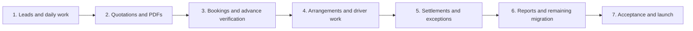

# Development phases and completion checklist

Status: Phase 5 explicitly approved and implemented; manual acceptance pending. See phase-5-report.md and feature-coverage-audit.md for delivered scope, limitations and remaining work. This remains the authoritative phase sequence, with detailed field rules, exceptions and access definitions in documents 01-08.

## Confirmed operating model

One owner, one sales executive and multiple operations members initially. Owner can add users later. Owner and sales coordinate bookings, hotels, suppliers and driver assignments. Owner prepares/approves quotations and verifies money. Drivers execute assigned trips; selected capabilities can be granted explicitly. No fixed group-departure inventory. In-app notifications and manual WhatsApp sharing only. User enters credentials manually.

## Phase map

Every phase includes real persistence, applicable task/notification events, permission enforcement, audit history, loading/error/empty states and meaningful verification. A phase is complete only when its business workflow works across separate authorized user sessions. Do not leave simulated actions behind.

## Phase 1 - Working lead desk

Outcome: owner assigns a customer enquiry; sales records details and follows up from My Day using shared live records.

### Deliverables

- [ ] Next.js/TypeScript project, dependency lockfile, scripts, environment validation, development instructions and reusable responsive UI.
- [ ] MongoDB connection, organization scope, initial indexes, validation, database migration/version record and safe development fixtures.
- [x] Owner bootstrap with no public administrator grant; staff invitation/account activation and public pending-access requests that require Owner role assignment and approval; login/logout, secure sessions and documented recovery path.
- [ ] Three roles plus controlled capabilities. Owner-only staff add/edit/deactivate; no hard-coded employee limit. Block removing/deactivating the last active owner.
- [ ] Central server authorization for routes, actions, record ownership, search, downloads and future jobs; field allowlists prevent role/assignee manipulation.
- [ ] Customer search/create/edit, existing-customer selection, duplicate suggestions and history links. Avoid automatic merges based on shared phone.
- [ ] Enquiry capture, draft save, required/optional sections, service responsibility, flexible dates, destinations/alternatives, adult/child/infant needs and notes.
- [ ] Source dropdown, first-contact deadline, assignment/acknowledgement, call outcomes, next action, lost/on-hold reasons and review date.
- [ ] My Day, enquiry list/detail, My Tasks and working calendar; owner team view and sales assigned view. Operations receives a minimal task view until trip features arrive.
- [ ] Follow-up create/reschedule/complete and linked enquiry updates; reassignment transfers open tasks and access.
- [ ] In-app notification inbox, unread count, deep links and persisted background reminder processing. Owner-configured deadline/escalation defaults.
- [ ] Real activity events with actor/time; distinguish imported historical notes from new actions.
- [ ] Customer/enquiry CSV/XLSX import preview, column mapping, row errors, duplicate review, staff mapping, provenance and idempotent commit.
- [ ] Workbook-specific legacy support: preserve 74 source enquiry rows and column K notes, flag wrong/uncertain dates and shifted data, review activation before creating tasks.
- [ ] Basic dashboard counts from authorized real records; no fake sales/finance figures before those modules exist.

### Edge cases and acceptance

- Missing dates/budget do not block saving an enquiry; missing usable contact can be retained only as a legacy review record with owner-visible warning.
- Duplicate customer contacts, repeat trips, inactive assignee, absent staff, wrong country code, date ambiguity and past follow-up deadlines are handled explicitly.
- Rescheduling creates no duplicate task; notification retries do not multiply alerts; reading a notification does not complete a task.
- Sales cannot retrieve another staff member's record using API URLs or exports. Revoked permissions take effect on server requests.
- Two users editing the same record see a conflict instead of silently overwriting changes.
- Demonstration: owner creates and assigns enquiry -> sales sees alert -> records call -> schedules follow-up -> task appears on correct date -> reschedules -> owner reassigns -> original staff loses access.

## Phase 2 - Quotations and customer decision

Outcome: sales requests a quote; owner prepares/approves a version; the system generates a PDF that sales can manually share.

### Deliverables

- [ ] Reusable package templates based on owner-corrected source material; template copy does not imply live availability or fixed price.
- [ ] Day-wise itinerary, hotels/rooms/nights/meals, transport legs, included/excluded services and optional activities.
- [ ] Hotel/meal alternatives, total/per-person/per-couple price basis, quantities, currency, discounts, approved tax settings, payment schedule, validity and cancellation terms.
- [ ] Separate internal cost notes and customer-facing prices; staff/document payloads omit unauthorized cost/margin fields.
- [ ] Quote-request queue, missing-information return, owner editor, preview, approval snapshot, document number and version history.
- [ ] Durable PDF job with retry/failure visibility, branding and Unicode-capable layout; permission-checked preview/download.
- [ ] Sales Send quotation task, manual WhatsApp share/download and channel/time log. Do not imply WhatsApp delivery/read tracking.
- [ ] Customer decision Pending/Accepted/Rejected, exact accepted version/option, acceptance date/channel/evidence and recorded-by.
- [ ] Expiry reminders, customer change requests and new revision flow. Editing a template does not alter a past quote.

### Edge cases and acceptance

- Quote request with incomplete requirements, customer chooses different options, stale/expired quote, room/itinerary mismatch, contradictory inclusions and old rates.
- Quote includes customer-held tickets for coordination only; no duplicated agency charges. Hotel-only requires no car/flight fields.
- Failed PDF generation keeps approved data intact and retries once per document version; sales cannot share a draft as approved.
- Double acceptance cannot create two bookings later; superseded versions cannot be accepted without deliberate owner-reviewed resolution.
- Demonstration: request -> owner approval -> PDF -> send -> revise -> new approval -> accept exact version. Verify old PDF remains unchanged.

## Phase 3 - Booking and verified advance

Outcome: customer acceptance becomes one booking; the owner verifies payments; sufficient advance releases operations work reliably.

### Deliverables

- [x] Idempotent conversion of accepted quote/option to booking with immutable agreement snapshot.
- [x] Customer/payer/traveller separation, lead traveller, service dates, basic traveller details and assigned owner/sales coordinator.
- [x] Booking summary and initial service checklist; status Awaiting advance vs Pending confirmation remains clear.
- [x] Agreed required advance, instalment/balance deadlines, payment submission/evidence and owner verification/rejection.
- [x] Core invoice draft/issue, document numbers, billing details, line/tax calculation, PDF and controlled void/correction prerequisites.
- [x] Customer payment allocations, unapplied credit, unique receipt for verified payment and balance calculations.
- [x] Payment verification atomically creates the applicable ledger event, updates derived balances and queues operations release once.
- [x] Release only when agreed advance is met or owner records an exception reason. Zero-advance terms need explicit owner release, not invented payment.
- [x] Pending verification, overdue advance and balance tasks/notifications; private evidence access.
- [x] Minimal service scaffolding sufficient for an operations checklist without representing unconfirmed inventory as confirmed.

### Edge cases and acceptance

- Screenshot is not verified payment. Partial, split, duplicate, misallocated, overpaid and rejected payments are explicit.
- Payer differs from travellers, payment predates invoice, currency mismatch, rounding and duplicate transaction references need review.
- Owner changes advance terms through an approved amendment; prior verified entries are preserved.
- A reversal after operations release creates an exception/review task rather than silently cancelling supplier commitments.
- Demonstration: accept -> partial payment -> no release -> remaining payment verified -> one checklist -> re-submit request -> no double credit/task.

## Phase 4 - Arrangements and trip execution

Outcome: owner/sales coordinate services, operations executes assignments, and customer/driver/supplier documents reflect real confirmations.

### Deliverables

- [x] Supplier directory and separate booking arrangements with service scope/dates, confirmation status/reference, agreed cost/currency and due date.
- [x] Owner/sales coordination capabilities, internal arrangement drafts, approval for cost/scope exceptions and controlled supplier commitment.
- [x] Hotel stays/rooms/meals; cars; flight/train/bus/ferry coordination references; activities; permits/visa assistance; customer-booked and third-party segments.
- [x] Own/vendor vehicle directory, availability, passenger/luggage capacity, driver assignment per leg and overlap prevention including travel buffer.
- [x] Mobile My Trips: assigned contact, pickup/drop, route, schedule, vehicle, assistance notes and progress updates.
- [x] Owner-granted driver edits for actual times, odometer, expense evidence and draft logistical change requests. Commercial changes require approval.
- [x] Traveller readiness, conditional document collection, private access, checklists, recorded-by/time and service confirmation gates.
- [x] Final itinerary, supplier/hotel voucher, passenger manifest and driver trip sheet with recipient-specific fields.
- [x] Trip incidents, delay/replacement workflow, customer-contact log and urgent owner/coordinator alerts.
- [x] Exceptional collection report form or owner entry on driver's behalf; pending verification, owner alert, duplicate detection and link to Phase 3 payment verification.
- [x] Separate driver cash-custody/handover tracking; who collected vs who entered vs who verified; partial handover and discrepancy review.
- [x] Trip-completed action, feedback task and outstanding settlement flag.

### Edge cases and acceptance

- Customer changes arrival time, hotel unavailable, temporary supplier hold expires, missed connection, overnight leg, international time zones, vehicle replacement and driver absence.
- Two simultaneous assignments cannot allocate the same vehicle/driver incompatibly. Multiple vehicles/sector drivers are supported.
- Driver cannot change another assignment, billing price or supplier payable. Revoked grant blocks an already-open edit form.
- Offline/failed save shows not-saved state and phone fallback; no false confirmation or unreviewed offline payment syncing.
- Driver and owner submitting the same collection creates one verified payment. Handover/deposit creates no additional customer credit.
- Demonstration: customer-held flight + agency hotel/car -> sales coordinates -> owner approves necessary commitment -> confirmations -> assigned driver executes -> incident replacement -> completion.

## Phase 5 - Settlements, changes, cancellation and refunds

Implementation: `src/server/settlements.ts`, `src/lib/settlement-domain.ts` and Money & changes UI. Test guide: `phase-5-manual-test.md`. Specific limits: two-decimal currencies, booking-level allocation, printable agreement adjustments (not statutory tax credit notes), and no spending supplier credits across bookings yet. Original checkboxes below are acceptance gates, not proof of manual sign-off.

Outcome: owner can reconcile customer/supplier money and handle changes without losing the original agreement or payment history.

### Deliverables

- [ ] Supplier invoices/dues/payment allocations, payment evidence, payable ageing and approved expenses.
- [ ] Customer outstanding balances, credit/adjustments, receipt reconciliation and driver cash reconciliation.
- [ ] Agreed-vs-actual costs, exact currency conversions and rate differences; label estimated margin separately from final profit.
- [ ] Booking amendment request, affected service review, revised quote/adjustment, owner approval and customer reconfirmation where applicable.
- [ ] Full/partial cancellation, effective date/reason, actual service usage, customer deduction and supplier penalty.
- [ ] Customer refund requested/approved/paid/pending, method/reference, approval history and adjustment documents.
- [ ] Supplier recovery expected/received/pending independently of customer refunds.
- [ ] Immutable financial events with reversals/corrections; no deleting verified history or manual override of aggregate paid totals.
- [ ] Cancel obsolete tasks and generate relevant cancellation/refund/recovery tasks; prevent accidental vendor cancellation for unaffected services.
- [ ] Financial closure criteria distinct from completed travel.

### Edge cases and acceptance

- One traveller cancels, service-only cancellation, nonrefundable cost, unused service, customer overpayment, supplier credit instead of cash, refund partly paid and disputed expense.
- Customer refund may be owed before supplier recovers money; these flows never automatically settle each other.
- Block excess allocation/refund; a separate compensation payment requires an explicit reviewed adjustment.
- Duplicate reversal/retry cannot reverse a payment twice. No staff member self-approves a financial action.
- Demonstration: partially cancel an accepted booking -> adjust customer agreement -> record supplier penalty -> approve partial refund -> pay in two instalments -> record recovery separately -> reconcile.

## Phase 6 - Reports, remaining imports and administration completion

Outcome: owner can use reliable filtered reporting and migrate additional historical records without guessing missing business data.

### Deliverables

- [ ] Supplier, package, traveller and historical booking imports with reference resolution and dedicated schemas.
- [ ] Reviewed financial migration: choose opening balance or historical transactions for a period; prevent double counting.
- [ ] Import batch progress/errors, corrected re-upload, idempotency, activation review and safe rollback/correction policy.
- [ ] Lead pipeline/source/assignee reports, quote turnaround and defined conversion metrics.
- [ ] Departures, service readiness, workload, overdue tasks and driver/vehicle schedule views.
- [ ] Financial reports separating booked value, invoiced amount, verified cash, customer balances, supplier payables, refunds and recoveries.
- [ ] CSV/XLSX downloadable exports honoring filters, permissions, currency/date definitions and spreadsheet-formula safety.
- [ ] Owner settings for agency branding/contact, reviewed bank details, numbering, tax configuration, payment/cancellation templates and reminder defaults.
- [ ] Staff workload, account status, reassign/deactivate flow, explicit capability grants and last-owner protection.
- [ ] Search across permitted customers/enquiries/bookings; no hidden costs leaked through search, totals or export columns.

### Edge cases and acceptance

- No source for confirmed bookings/payments means leave them absent, not inferred from quote-sent notes or empty sheets.
- Historical imports do not fire current customer messages/reminders. Import owner review is separate from task activation.
- Same file repeated, corrected row imported, unknown staff, duplicate serial IDs and partial batch failure preserve provenance.
- Report filters/exports agree with underlying authorized records; chart zero and unavailable data are distinguishable.
- Demonstration: migration preview -> correction -> import -> repeat without duplicates -> filter real report -> download matching CSV/XLSX.

## Phase 7 - Acceptance and live release

Outcome: owner, sales and operations can safely use the complete approved application with real records.

### Deliverables

- [ ] Run document 06 acceptance scenarios plus phase-specific cases above, with separate user sessions.
- [ ] Typecheck/lint/production build and critical integration/end-to-end tests; do not treat a successful build as proof of workflow correctness.
- [ ] Mobile/desktop, keyboard navigation, labels/contrast, large tables, long names, Unicode PDF layout and empty/error/loading states checked.
- [ ] Unauthorized route/action/download/export tests, session revocation, upload validation, CSRF/origin handling as appropriate, rate limiting and secret-redacted logging.
- [ ] Transaction retry, concurrent updates, duplicate commands, job retry, missed reminder recovery, PDF failure and notification deduplication checks.
- [ ] User enters production secrets; validate names/configuration without printing secret values.
- [ ] Separate staging/production, working Node hosting, reliable job scheduler, TLS/domain, monitoring and operational error visibility.
- [ ] Confirm backup retention with chosen Atlas plan; perform restore rehearsal and document rollback.
- [ ] Owner approves source cleanup/import mapping and verifies a small live-data migration before the remainder.
- [ ] Realistic user walkthroughs: local car trip, hotel-only, customer-booked transport package and international trip.
- [ ] Owner/user guide, support/runbook, data export/recovery instructions and AI context update.
- [ ] Production smoke check with authorized accounts; no public CRM data, fake reports or placeholder actions.

## Cross-phase feature ownership

| Feature                              | Introduced                     | Completed/extended                                            |
| ------------------------------------ | ------------------------------ | ------------------------------------------------------------- |
| Authentication, RBAC, staff growth   | 1                              | 4 delegated capabilities; 6 administration; 7 access tests    |
| Customers/enquiries/follow-up/tasks  | 1                              | Events added in every subsequent phase                        |
| In-app notifications/background jobs | 1                              | Quote, finance and operations events in 2-5; reliability in 7 |
| CSV/XLSX import                      | 1 customers/enquiries          | 6 remaining records and finance                               |
| Quotations/itinerary PDF             | 2                              | 4 final itinerary/vouchers; 5 amendments                      |
| Booking/payment verification         | 3                              | 4 collections; 5 settlement/corrections                       |
| Invoice/receipt PDF                  | 3                              | 5 adjustments/refunds                                         |
| Suppliers/vehicles/drivers/readiness | 4                              | 5 costs and recovery                                          |
| Cancellation/refund/recovery         | 5                              | 6 reporting and migration                                     |
| Reports/export                       | Basic counts 1                 | 6 full reports/CSV/XLSX; 7 reconciliation checks              |
| Cloudinary                           | Architecture 1; needed media 2 | 3 evidence; 4 protected travel documents                      |

## Approval and scope boundaries

Phase 1 is the first useful working slice, not the finished CRM. It may be tested as a controlled pilot after its checks pass, but does not promise booking/financial operations until those phases are complete. Full launch follows Phase 7.

No fixed departure inventory, automated WhatsApp notifications, live flight/train ticketing, automatic hotel inventory, payment gateway, customer portal, GPS tracking or AI-generated approved prices in this plan. More staff is supported through settings; extra branches/agency tenancy changes need separate scoping.

The exception register is a living checklist of known cases, not a guarantee that every future real-world situation can be predicted. Newly discovered cases are recorded, assigned to a phase and tested before relevant release.
