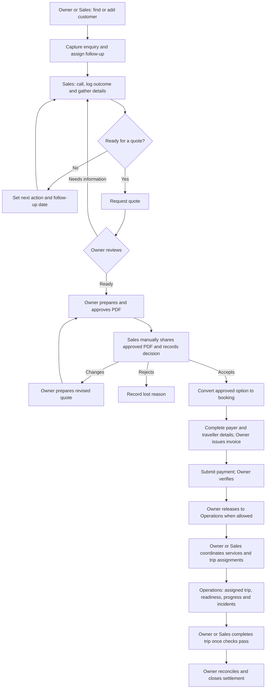

# Enquiry quick customer entry — changes and review

## What changed

In **Enquiries → New enquiry**, **Add customer** opens a short form beside the customer search. Enter a name and a phone number with country code or an email address. **Save and select customer** creates the customer through the existing customer API and selects it in the open enquiry. The enquiry itself is saved only when you select **Save changes**. If you abandon the enquiry after saving the customer, the customer remains in the directory.

The same action is available while editing an enquiry. Quick entry retains the normal Owner/Sales access, contact validation and duplicate check. It does not override possible matches. Canceling quick entry leaves the current customer selection and enquiry draft intact.

## What to check

1. As Owner, open a new enquiry and enter destination and follow-up details first. Add a new customer; confirm their name is selected and the details you entered remain. Save, reopen the enquiry, and verify that it points to the same customer.
2. As Sales, try an email-only customer, then a phone-only customer without +91. Indian phone numbers are normalized on save, and numbers outside India should include their country code. Confirm invalid and missing contact details show an error without losing the enquiry draft.
3. Try a known phone or email. Confirm you get a possible-duplicate message and can cancel, then search and select the existing customer if it is visible to you.
4. Open the form on a phone. Try Cancel after selecting an existing customer; then add and select a new one. Verify that quick entry never saves the whole enquiry on its own.
5. As Owner, assign the saved enquiry to Sales and set both a next action and a date. As Sales, check the enquiry and follow-up task. As Operations, confirm you do not have access to Enquiries.

## Current workflow for review

- **Owner:** Capture/assign/reassign enquiries → review, prepare and approve quotations → issue invoice → verify payment → release Operations → oversee supplier commitments and trip completion → close settlement. Owner also manages accounts, reviews attendance requests and views team activity.
- **Sales:** Assigned enquiry → acknowledge → call and record outcome → set follow-up or request quote → fill any missing details → share approved PDF manually → record the customer decision → convert accepted option to booking → enter payer/travellers and submit payment evidence → coordinate allowed services and trip work.
- **Operations:** Released and assigned trip → view relevant trip details → use readiness checklist → update authorized progress and times → report incidents or permitted expenses/requests → finish assigned segments. Operations do not have access to enquiry/quote/payment work. Sales and Operations can use their own attendance and request off-site attendance for Owner review.

Release requires an issued invoice and the verified advance or the Owner's recorded exception; a zero-advance booking also needs a recorded reason. Trip completion requires confirmed agency arrangements, completed active segments, resolved readiness items and no open incidents. Financial closure is separate.

## Other in-context actions to review before building

1. **Enquiry → follow-up:** Make the linked task easier to open from the enquiry while keeping the existing single follow-up task.
2. **Enquiry → quote request:** Put a clear list of missing details next to the request button.
3. **Booking → next action:** Show the relevant invoice, payment verification, or Operations release action on the booking, according to the signed-in role.

These are proposals only. Correct the role handoffs or gates above before expanding them.
