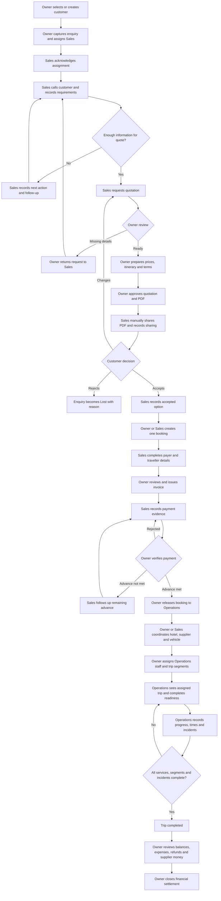

# EarlyBird CRM — one enquiry to completed trip

Updated: 4 November 2026

This workflow describes what the current code implements. It is not a proposed generic CRM flow.

## Simple workflow chart

Open `docs/enquiry-to-trip-role-workflow.html` in a browser for the visual version.

## Who does what

### Owner

- Selects an existing customer or creates a customer.
- Captures an enquiry and assigns it to Sales.
- Can see every enquiry and reassign it.
- Reviews quotation requests.
- Returns a request when information is missing.
- Prepares prices, options, itinerary, inclusions, exclusions, advance and cancellation terms.
- Approves the quotation and generates the locked customer PDF.
- Configures and issues invoices.
- Verifies or rejects payment evidence. Submitted evidence is not treated as money before this verification.
- Releases the booking to Operations only after the required advance, or records an allowed exception.
- Manages suppliers, vehicles, staff permissions, financial changes, refunds and final settlement.

### Sales

- Sees only enquiries assigned to that Sales account.
- Acknowledges new assignments.
- Calls the customer and records requirements, call result, next action and follow-up date.
- Requests a quotation after required details are available.
- Supplies missing information when the Owner returns a request.
- Downloads and manually shares an approved PDF.
- Records when/how it was shared; this does not mean WhatsApp delivery or read confirmation.
- Records the customer's exact decision and selected approved option.
- Creates the booking from the accepted quotation.
- Completes payer, traveller and coordination information.
- Submits payment evidence for Owner verification.
- Coordinates service drafts/holds, but the Owner controls financial commitments and approvals.

### Operations staff

- Cannot see ordinary enquiries, quotation prices, invoices, payment evidence, GST, supplier costs or margin.
- Sees a trip only after the Owner releases it and assigns that Operations account.
- Sees the route, pickup/drop, traveller assistance information, vehicle and schedule needed to perform the trip.
- Updates permitted trip times, notes, readiness and progress.
- Reports delays, incidents, expenses or logistical requests according to granted capabilities.
- Cannot approve commercial changes or verify customer money.
- Completes assigned segments. Trip completion is blocked while required services/readiness are incomplete or an urgent incident remains unresolved.

## How to record one enquiry

### 1. Owner captures and assigns

1. Open **Enquiries → New enquiry**.
2. Search and select the customer. The form now shows `Selected: customer name`.
3. Enter source, destination and first-contact time.
4. In **Assigned to**, choose the Sales user. New Owner-created enquiries now prefer the active Sales user by default.
5. If scheduling a follow-up, enter both **Next action** and **Next follow-up**.
6. Save.

Result: one enquiry, one follow-up task and one notification are created for the assigned Sales user. An enquiry assigned to the Owner is deliberately invisible to Sales.

### 2. Sales gathers requirements

Sales records:

- call outcome;
- destination and possible dates;
- adults, children and infants;
- services required;
- hotel/room preference;
- pickup and drop-off;
- budget and basis;
- special requirements;
- next action and follow-up.

When a task becomes Waiting, Done or Cancelled, or its due date changes, a work note is required so the activity history explains what happened.

### 3. Sales requests quotation

The code checks the enquiry before allowing a request. It requires destination/date information, traveller count, required services, and service-specific information such as hotel preference/rooms or pickup/drop-off.

### 4. Owner prepares and approves

The Owner can return the request to Sales or prepare the quotation. Only the Owner edits commercial pricing and approves it. Approval locks a version and generates the customer PDF.

### 5. Sales shares and records the decision

Sales records manual sharing only after the approved PDF is ready. Customer acceptance must identify one approved option and include a reference or evidence note. Changes create another review/revision; rejection records a reason.

### 6. Booking and invoice

An accepted quotation creates one booking and one invoice draft. Retrying conversion returns the existing booking instead of creating another. Sales completes payer/traveller details; the Owner checks tax lines and issues the invoice.

### 7. Payment and Operations release

Sales submits payment evidence. The Owner verifies or rejects it. The booking remains Awaiting advance until verified money meets the agreed advance. The Owner then releases it to Operations and assigns staff.

### 8. Services and trip execution

Owner/Sales coordinate hotel, cab, activities and customer-held transport. Operations works only assigned segments, reports progress/incidents and completes readiness. The system blocks overlapping driver/vehicle assignments and insufficient capacity.

### 9. Trip and financial completion

Trip completion requires confirmed active services, completed segments, required readiness and resolved urgent incidents. It does not automatically mean the customer/supplier money is settled. The Owner separately resolves balances, refunds, expenses and supplier obligations before financial closure.

## Why the Subash enquiry was missing for Sales

The record shown in the application was assigned to `earlybird`, the Owner. Server-side access intentionally returns Sales only records whose `assigneeId` matches that Sales account. Edit the Subash enquiry as Owner and change **Assigned to** to `User`. Its open follow-up task and future quote/booking ownership will move with the enquiry.

## Code rules used for this explanation

- `src/server/crm.ts`: assignment access, enquiry save, follow-up task and notification behaviour.
- `src/server/quotes.ts`: request, return, Owner approval, PDF sharing and customer decision.
- `src/server/bookings.ts`: accepted quote conversion, invoice issue, payment verification and Operations release.
- `src/server/operations.ts`: arrangements, driver/vehicle assignments, readiness, incidents and trip completion.
- `src/server/settlements.ts`: changes, refunds, supplier obligations and financial closure.

